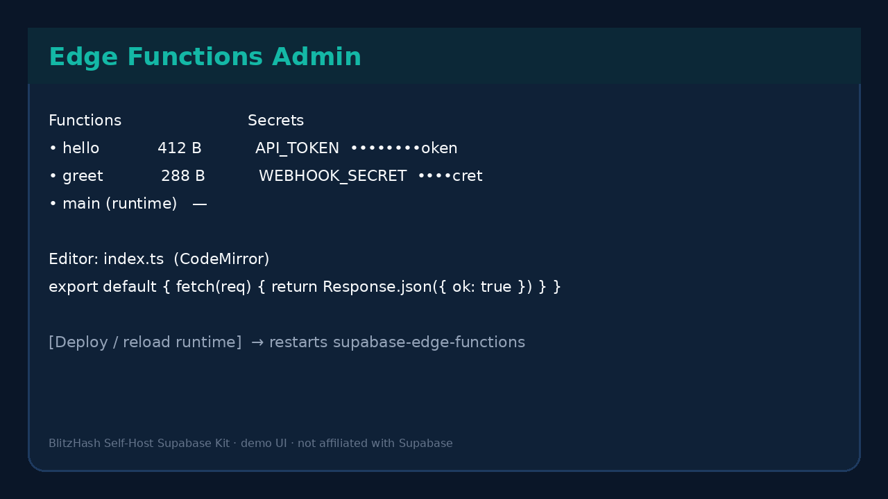
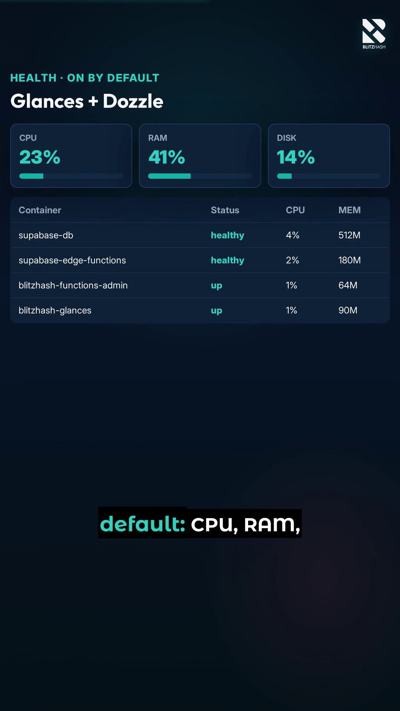

# Self-Host Supabase Kit by BlitzHash

**One command to stand up official self-hosted Supabase, plus an Edge Functions admin UI (Studio can’t), host/container health dashboards, and ready-made rules for Cursor, Claude, Antigravity, Qoder, or any IDE.**

[](LICENSE)
[](https://github.com/blitzhash360-web/blitzhash-supabase-selfhost-kit/actions/workflows/ci.yml)
[](https://github.com/blitzhash360-web/blitzhash-supabase-selfhost-kit/stargazers)

> **Not affiliated with Supabase.** Supabase® is a trademark of Supabase, Inc. This project is independent and is not endorsed by or sponsored by Supabase, Inc. We say “for Supabase” only to describe what the tools work with.

## Quick start (3 steps)

```bash
# 1. Clone
git clone https://github.com/blitzhash360-web/blitzhash-supabase-selfhost-kit
cd blitzhash-supabase-selfhost-kit

# 2. Need Docker + Docker Compose v2, git, openssl, Node 18+
./setup.sh -y
# or: make setup

# 3. Open Studio (URL printed by setup) and the companion UIs below
```

`setup.sh` checks Docker, **fetches the official** [`supabase/supabase` `docker/`](https://github.com/supabase/supabase/tree/master/docker) tree at a **pinned** tag (`self-hosted/v0.8.3` by default — Apache-2.0 upstream, credited in [NOTICE](NOTICE)), generates strong secrets (via upstream `generate-keys.sh` / `add-new-auth-keys.sh`), layers the BlitzHash kit overlay, and starts the stack.

## Deploy (VPS / Docker host)

This kit is **not** a single standalone `docker-compose.yml`. `./setup.sh` must run first: it sparse-clones the official [`supabase/supabase` `docker/`](https://github.com/supabase/supabase/tree/master/docker) tree at a pinned tag, generates secrets, copies the BlitzHash overlay (Functions Admin + Glances + Dozzle), then starts Compose. A raw Hostinger `compose_url` pointed at [`overlays/docker-compose.kit.yml`](overlays/docker-compose.kit.yml) alone **will not work** (missing upstream services, build context, and secrets). We intentionally do **not** ship a broken one-click button for that reason.

**One-liner on a fresh VPS** (Docker + Compose v2, git, openssl, Node 18+):

```bash
git clone https://github.com/blitzhash360-web/blitzhash-supabase-selfhost-kit.git \
  && cd blitzhash-supabase-selfhost-kit \
  && ./setup.sh -y --public-url "https://YOUR_DOMAIN_OR_IP"
```

Omit `--public-url` to keep the default `http://localhost:8000` (SSH tunnel / localhost binds). After setup, open Studio and the companion UIs printed by the script. Day-2: `./bin/blitzhash-supabase doctor`.

**Hostinger:** create a VPS with [Docker Manager](https://www.hostinger.com/support/12040815-how-to-deploy-your-first-container-with-hostinger-docker-manager/), SSH in, run the one-liner above. When we publish a true single-file Compose artifact that is safe to one-click (without rebranding upstream Supabase), we will add a [Deploy on Hostinger](https://www.hostinger.com/support/deploy-on-hostinger-button/) button (`compose_url=` raw YAML). Until then, the VPS one-liner is the supported path.

**Not for Railway/Render as this repo:** those platforms do not run Compose with `docker.sock` the way this kit needs. Prefer a VPS or a self-host panel. See BlitzHash growth notes for template platforms.

## What you get

| Piece | What it is |
|---|---|
| Official Supabase stack | Studio, Auth, PostgREST, Realtime, Storage, Edge Runtime, Postgres, … |
| **Edge Functions Admin** | Create / edit (CodeMirror) / delete / deploy functions; manage secrets (masked). Studio cannot do this on self-hosted. |
| **Health (on by default)** | [Glances](https://github.com/nicolargo/glances) (LGPL-3.0) host + container metrics; [Dozzle](https://github.com/amir20/dozzle) (MIT) live logs |
| Day-2 commands | `doctor`, `backup` / `restore` (`pg_dump`), `update`, `down` |
| AI IDE pack | `AGENTS.md`, Claude skill, Cursor rules, Windsurf/Devin, Copilot, Antigravity, Qoder, MCP example |



<sub>Edge Functions Admin — edit `index.ts`, manage masked secrets, Deploy restarts `supabase-edge-functions`.</sub>



<sub>Glances health UI — host CPU/RAM/disk and per-container stats (bound to localhost by default).</sub>

### Companion URLs (default binds = localhost only)

| UI | URL | Auth |
|---|---|---|
| Studio / API gateway | `http://localhost:8000` | Studio basic auth |
| Edge Functions Admin | `http://127.0.0.1:9100` | Same Studio credentials (or `FUNCTIONS_ADMIN_*`) |
| Glances | `http://127.0.0.1:61208` | Prefer localhost; optional password in `glances.conf` |
| Dozzle | `http://127.0.0.1:8080` | Studio credentials |

### Linking Functions Admin from Studio (honest)

Self-hosted Studio does **not** expose a supported first-party nav hook for a custom “Edge Functions” editor without forking Studio. The kit therefore:

1. Prints the admin URL after setup  
2. Writes `supabase-project/volumes/kit/STUDIO_LINKS.md`  
3. Ships an optional Caddy snippet (`overlays/Caddyfile.functions-admin.snippet`) so you can serve `/functions-admin` on the same HTTPS domain  

Details: [docs/FUNCTIONS-ADMIN.md](docs/FUNCTIONS-ADMIN.md) · [docs/HEALTH.md](docs/HEALTH.md)

## Commands

```bash
./setup.sh -y                         # first-time
./bin/blitzhash-supabase doctor       # compose ps + kit ports + JWT check
./bin/blitzhash-supabase backup       # gzipped pg_dump → supabase-project/backups/
./bin/blitzhash-supabase restore FILE
./bin/blitzhash-supabase update       # re-fetch pin + recreate
./bin/blitzhash-supabase down
# Makefile aliases: make up down doctor backup update test shellcheck
```

## AI IDE integration

| IDE | Use |
|---|---|
| Universal | [`AGENTS.md`](AGENTS.md) |
| Claude Code | [`CLAUDE.md`](CLAUDE.md) + [`skills/supabase-selfhost/`](skills/supabase-selfhost/) |
| Cursor | [`.cursor/rules/*.mdc`](.cursor/rules/) |
| Windsurf / Devin Desktop | [`.windsurf/rules/`](.windsurf/rules/) + [`.devin/rules/`](.devin/rules/) (AGENTS.md fallback) |
| GitHub Copilot | [`.github/copilot-instructions.md`](.github/copilot-instructions.md) |
| Google Antigravity | `AGENTS.md` + [`.agents/rules/`](.agents/rules/) |
| Qoder | `AGENTS.md` + [`.qoder/rules/`](.qoder/rules/) |

MCP example (env vars, read-oriented): [`mcp/mcp.json.example`](mcp/mcp.json.example). **Never** commit secrets; **never** put `SERVICE_ROLE_KEY` / `SUPABASE_SECRET_KEY` in frontend code.

More: [docs/IDE.md](docs/IDE.md)

## Security notes

- Admin ports default to **127.0.0.1**  
- Glances/Dozzle mount `docker.sock` **:ro** (API is still powerful — keep UIs private)  
- Functions Admin needs **RW** `docker.sock` only to restart the edge-runtime on Deploy  
- Secrets file `volumes/functions/.env.functions` is mode `0600`; values masked in the UI and never logged  

## Going to production? What this doesn’t cover

These scripts get the basics right. A production setup for a real business also needs:

- **Offsite backups** and restore drills (local `pg_dump` is not enough)  
- **HA / failover** for Postgres and the API gateway  
- **Scaling** Storage, Realtime, and connection pooling under load  
- **Monitoring & alerting** beyond a localhost Glances tab (paging, uptime checks)  
- **Security hardening** (WAF, network policies, secret managers, key rotation)  
- **Upgrade runbooks** for upstream self-hosted pins and one-way migrations  
- **Cost tuning** (right-size VMs, drop unused services, egress)  

Want a senior team to look at yours? Get a free assessment at **[blitzhash.com](https://blitzhash.com)**.

See also [docs/PRODUCTION.md](docs/PRODUCTION.md) (Caddy/HTTPS, firewall tips, SMTP).

## Credits

- Official self-hosting Docker Compose and scripts: [supabase/supabase `docker/`](https://github.com/supabase/supabase/tree/master/docker) (Apache-2.0). This kit **fetches** them at a pinned tag; it does not rebrand upstream code.  
- [Glances](https://github.com/nicolargo/glances) (LGPL-3.0-only), [Dozzle](https://github.com/amir20/dozzle) (MIT), CodeMirror 5 (MIT, CDN). Notices: [overlays/THIRD_PARTY_NOTICES](overlays/THIRD_PARTY_NOTICES) · [NOTICE](NOTICE)

## License

MIT © BlitzHash for kit code. Upstream Supabase Docker files remain Apache-2.0. See [LICENSE](LICENSE) and [NOTICE](NOTICE).

---

Built by BlitzHash: need a senior team to check or scale your AI-built app? Free assessment at https://blitzhash.com
